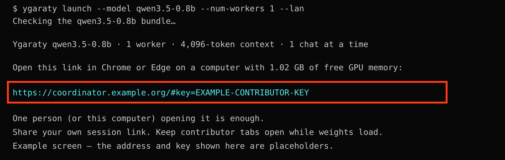

<p align="center">
  
</p>

[Documentation](https://ygaraty.github.io/ygaraty/)

**Ygaraty is an open-source framework for distributed computation.** We aim to
provide the building blocks for any kind of mathematical computation to run
across heterogeneous devices and networks, with compute contributed by one
person or many collaborators.

Our compiler, analyzer, Tape and execution engine turn that goal into reusable
pieces for describing, planning and running computations. **Today, Ygaraty
supports inference with or without distribution** through browser or native
WebGPU workers. Chat from your terminal, browser, or an OpenAI-compatible app
or SDK. [TESTED.md](TESTED.md) records measured configurations and limitations.

**[Distributed training is ongoing open research](#training-diloco-open-research)**,
including DiLoCo and experiments with our compiler and execution engine. Follow
our [public experiments](research/README.md#reports) for methods, results and
limitations, and help reproduce or extend the work.

We build in the open: compiler, analyzer, runtime, tape, training code and
[research](research/README.md). Bring an experiment, a new backend, a benchmark,
a bug fix or a better explanation. Small contributions are welcome—give them a
clear purpose and enough evidence for someone else to check and build on them.
See [how to contribute](CONTRIBUTING.md).

## Install

Requires Python 3.12+, Git and curl. See [setup details](docs/quickstart.md) if needed.

```sh
curl -fsSL https://raw.githubusercontent.com/ygaraty/ygaraty/main/install.sh | bash -s -- --install-only
export PATH="$HOME/.local/share/ygaraty/venv/bin:$PATH"
```

The `export` above makes `ygaraty` available only in the current terminal.
To keep it available in new terminals, add the same line to your shell's startup
file: `~/.zshrc` for Zsh or `~/.bashrc` for Bash. Create the file if needed, save
it, then open a new terminal. If Bash starts as a login shell, make sure your
`~/.bash_profile` sources `~/.bashrc`.

Stop the server, then update without deleting models or session files:

```sh
ygaraty update
```

Restart with the same workspace. For older installations, see
[update instructions](docs/quickstart.md#update-ygaraty).

## Launch

```sh
ygaraty launch --model qwen3.5-0.8b --num-workers 1
```

This needs **one contributor with about 1 GB of free GPU memory**: a laptop's
integrated GPU is enough, and it can be this same computer. Launch prints a
contributor link; **open it in Chrome or Edge and click Accept and contribute**.
No checkpoint, cloud account or domain is needed.



**Share the link marked in red with your contributors—or open it yourself.**
The example illustrates a session launched with `--lan`; its address and key
are placeholders. Share the actual link printed by your own session.
Each contributor checks its GPU and downloads the weights for the model layers
it will process. Keep the contributor tabs open and wait for all workers to
finish loading; the terminal chat starts when the model is ready.

**Share beyond this computer** by adding one option:

- `--lan` — devices on your local network (Wi-Fi or cable). Links use this
  machine's network address over HTTPS with a self-signed certificate; each
  device accepts the browser warning once.
- `--public` — anyone on the internet, through a free
  [Cloudflare quick tunnel](https://github.com/cloudflare/cloudflared). Install
  `cloudflared` first (`brew install cloudflared`, `sudo pacman -S cloudflared`
  or [its releases](https://github.com/cloudflare/cloudflared#installing-cloudflared));
  the address is temporary and slower than `--lan`.

```sh
ygaraty launch --model qwen3.5-0.8b --num-workers 1 --lan
ygaraty launch --model qwen3.5-0.8b --num-workers 1 --public
```

Choose a model below and **1–4 workers**. Ygaraty selects the matching public
Spaces bundle and prints estimated GPU RAM per worker.

## Tested models

Summary of [TESTED.md](TESTED.md), which has time to first token, every
concurrency level and the earlier runs across real networks.

| Model | `--model` | GPU RAM per worker (1 / 2 / 4 workers) | Context | Concurrent chats tested | Measured speed |
| --- | --- | --- | --- | --- | --- |
| Qwen3.5-0.8B | `qwen3.5-0.8b` | 1.0 / 0.8 / 0.7 GB | 4,096 | 4 | 50 tok/s alone, 92 tok/s across 4 chats (2 workers, Radeon 680M) |
| S5-Nano | `s5-nano` | 3.8 / 2.4 / 1.5 GB | 4,096 | 4 | 16 tok/s alone, 24 tok/s across 4 chats (2 workers, Radeon 680M) |
| Qwen3.5-9B | `qwen3.5-9b` | 7.4 / 3.9 / 2.1 GB | 4,096 | 4 | 33 tok/s alone, 59 tok/s across 4 chats (2 workers, RTX 3090) |
| Qwen3.8-27B | `qwen3.8-27b` | 20.9 / 10.7 / 5.6 GB | 4,096 | 4 | 13 tok/s alone, 24 tok/s across 4 chats (2 workers, RTX 3090) |

Limits that apply to every model today:

- **Context:** 16,384 tokens per conversation, prompt and replies together.
  `--context` can lower it to save GPU memory.
- **Concurrency:** one chat at a time by default. `--slots N` serves up to N
  conversations at once (1–16 accepted; up to 4 tested). Each slot adds memory
  and the chats share the GPUs, so per-chat speed drops as more run.
- **Replies:** at most 4,096 tokens each; requests can lower it with `max_tokens`.
- **Text only:** image and video inputs are not supported, and Qwen thinking
  mode is off.
- **Workers:** 1–4 per model, from the published bundles.

Speeds are single runs with every worker on one GPU; spread across real
networks they depend on the slowest link. Qwen3.8-27B's answers match
llama.cpp's on the same Q4_K_M weights for their first 37–483 characters,
then differ only where two next words are nearly tied.

## Bring contributors

**Share the contributor link** printed by launch. Each person who opens it in
Chrome or Edge and clicks **Accept and contribute** becomes one worker; launch
shows who joined and each worker's progress. Keep those tabs open. Bigger
models need more workers or more GPU memory each (see [Tested models](#tested-models)).

## Contributors from command line

In another terminal, use the contributor link printed by launch:

```sh
ygaraty contribute 'CONTRIBUTOR_LINK' --runtime headless --num-workers 2
```

Or choose a native runtime: `deno` (also called `wgpu`), `node`, or experimental
`bun`. For example:

```sh
ygaraty contribute 'CONTRIBUTOR_LINK' --runtime deno --num-workers 2
```

Commands accept participation automatically. Workers on one GPU share its
memory; Ctrl-C stops them. Chromium supports WebRTC and TURN; native workers
currently use the coordinator relay.

See [runtime setup, GPU checks and per-runtime scripts](docs/contributing-gpu.md#contributors-from-command-line).

## Chat your way

- **Terminal:** chat starts automatically in the launch terminal once the model is ready.
- **Web:** open the private chat link, or add `--open-chat` to launch.
- **SDK or app:** use the printed `/v1` URL as the base URL, the contents of the
  printed `owner.key` file as the API key, and `qwen3.5-0.8b` as the model name
  (or your selected model). Use Chat Completions with `temperature=0`.
  See [API examples](docs/api.md).

Keep the server and contributors running. Share only the contributor link;
keep the private chat link and owner key private.

## Training: DiLoCo open research

Train a small residual ConvNet on MNIST or Fashion-MNIST with **1–4 contributors**,
using our Tape, compiler and WebGPU engine. Each worker holds the full model,
runs local Adam or Muon steps, then synchronizes through the coordinator.
Supported local rounds keep forward/backward tensors and optimizer state on GPU.

From a source checkout (training remains experimental):

```sh
python -m pip install -e '.[server]'
ygaraty train serve --dataset fashion-mnist --num-workers 2 \
  --optimizer muon --local-steps 8 --batch-size 16 --rounds 10 \
  --run-dir runs/fashion-muon --open-browser
```

Open the printed link in two browser tabs and click **Start contributing**, or
share it with another contributor using `--share` ([setup](docs/distributed-training.md)).

**Earlier GPU-resident benchmark:** three-seed medians, 15,360 Fashion-MNIST
samples, RTX 3060 GPUs on one host (before the latest coordinator fixes):

| Implementation | GPUs | Training time | Final loss |
|---|---:|---:|---:|
| Ygaraty DiLoCo + Muon | 1 | 239.6 s | 1.220 |
| Ygaraty DiLoCo + Muon | 4 | 171.3 s | 0.771 |
| PyTorch MuLoCo-1 reference | 1 | 15.1 s | 1.139 |

Four workers improved final loss and total runtime, but **did not beat MuLoCo-1**.
Ygaraty includes startup and evaluation; PyTorch reports setup separately.
See [method and limits](research/resident-training-nvidia.md).
Later coordinator fixes measured **1.63× / 2.38×** improvements with one/four
contributors on one M1 GPU, with identical losses. Those fixes have **not been
retested on NVIDIA**; the two measurements cannot be multiplied together.

[DiLoCo guide, implementation and results](docs/distributed-training.md) ·
[Local optimization evidence](research/coordinator-overhead-local.md) ·
[Open training experiments](research/README.md#diloco-training)

[Quickstart](docs/quickstart.md) · [Models & RAM](docs/public-bundles.md) ·
[Advanced settings](docs/advanced.md) · [WebRTC & TURN](docs/turn.md) ·
[Troubleshooting](docs/troubleshooting.md) · [Python API & training](docs/python-api.md)

Experimental · [MIT licensed](LICENSE)

## Latest improvements

**November 2026 · now on main; training remains experimental**

- **DiLoCo training with Adam or Muon:** browser and native WebGPU contributors
  train through our Tape and compiler. [Training guide](docs/distributed-training.md).
- **GPU-resident local training:** supported rounds keep forward/backward tensors,
  weights and optimizer state on GPU. [Implementation and results](research/resident-training-local.md).
- **Less coordinator overhead:** cached assignments and long polling delivered
  **1.63× / 2.38×** local speedups with one/four contributors sharing an M1 GPU,
  with identical losses. NVIDIA validation is still pending.
  [Measurements](research/coordinator-overhead-local.md).
- **Reproducible public benchmarks:** one-versus-four NVIDIA GPU results and a
  MuLoCo-1 comparison include trial data, correctness checks and source hashes.
  [Results and limitations](research/resident-training-nvidia.md).
