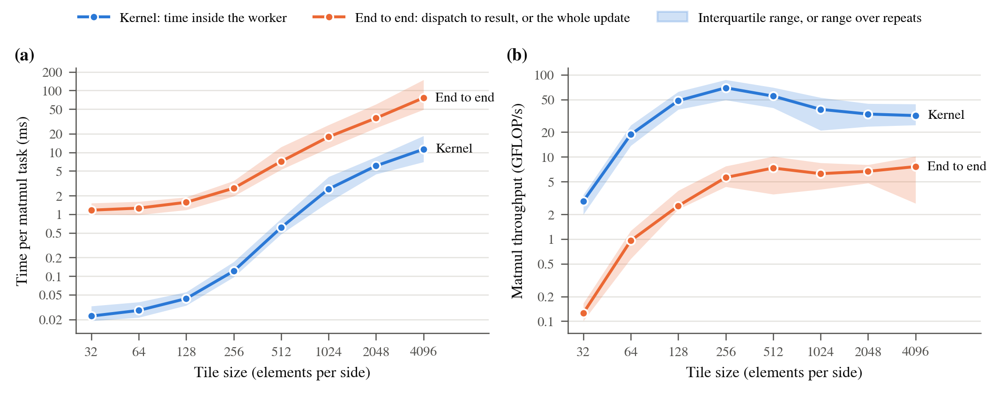

# Tile size: kernel speed versus whole-update speed

| | |
|---|---|
| **Date** | 2026-10-25 |
| **Path** | ZeroMQ, in-memory coordinator, 4 single-threaded workers on the same machine |
| **Result** | On an Apple M1, the matmul kernel peaks at tile 256 (69 GFLOP/s on one core), but whole updates are fastest from tile 512 up (about 2.5 s), and reach only a few percent of the workers' kernel capacity: coordination dominates. |
| **Evidence** | `public/research/figures/tile-sweep-apple-m1.png` (data embedded in the PNG) |

## Question

How does the tile size change the time to compute one training update? Smaller tiles mean more, cheaper tasks; larger tiles mean fewer, heavier ones. We measure two things for every matrix product: the kernel time inside the worker, and the end-to-end time from dispatch to result. We also measure the wall time of the whole update.

## Setup

- **Model:** `ygaraty.examples.sized_mlp`, batch 64, 1024 → 32,768 → 512, ReLU, cross-entropy, SGD. That's 50.4M parameters, 403 MB of float64 weights: the power-of-two hidden size closest to 500 MB.
- **Execution:** the real ZeroMQ server (`--save none`, no disk), with transposes and assemblies done on the coordinator, and 4 worker processes with one BLAS thread each. Input caching was off.
- **Tiles:** 32 to 4096. One update of warm-up, then one measured update per run, and 3 repeats interleaved across tile sizes. Tile 16 would need 2.6 million tasks per update.
- **Machine:** Apple M1 (4 performance and 4 efficiency cores, 16 GB), macOS, NumPy 2.1.1 with Accelerate. The machine was not idle: load average was about 10 on 8 cores throughout.

## Results



| Tile | Tasks per update | Kernel ms per matmul | End-to-end ms per matmul | Kernel GFLOP/s (one core) | Whole update GFLOP/s | Seconds per update |
|---:|---:|---:|---:|---:|---:|---:|
| 32 | 357,570 | 0.023 | 1.17 | 2.9 | 0.13 | 154.0 |
| 64 | 52,802 | 0.028 | 1.26 | 18.8 | 0.96 | 20.2 |
| 128 | 14,122 | 0.043 | 1.56 | 48.3 | 2.53 | 7.6 |
| 256 | 3,998 | 0.121 | 2.64 | **69.4** | 5.62 | 3.4 |
| 512 | 1,240 | 0.610 | 7.14 | 55.0 | 7.32 | 2.6 |
| 1024 | 503 | 2.56 | 17.8 | 37.9 | 6.25 | 3.1 |
| 2048 | 263 | 6.07 | 35.9 | 33.3 | 6.68 | 2.9 |
| 4096 | 143 | 11.2 | 76.0 | 31.9 | 7.62 | 2.5 |

Medians over all matmul tasks of 3 runs; the whole-update column is the median over runs, and the figure shows its range.

**Small tiles drown in coordination.** At tile 32 a matmul spends 0.02 ms computing and about 1.1 ms in dispatch, serialization, transfer and decoding. Updates take two and a half minutes.

**The kernel peaks at tile 256 and slows beyond.** This holds in a single process with no network at all, and gets worse with four processes at once. Above tile 512 a task's inputs and output exceed the M1's 12 MB shared L2 cache. On M1 the matrix unit used by Accelerate is also shared between cores. Thin products, whose inner dimension is the batch size (64), are memory-bound and make up more of the work at large tiles.

**Whole updates level off from tile 512.** Bigger tiles amortize coordination until the kernel slowdown cancels the gain. Even then, the system delivers only about 7 GFLOP/s against roughly 4 × 50 GFLOP/s of worker kernel capacity. The single coordinator, which moves every byte and runs the transposes and assemblies, is the bottleneck.

## Limits

Two earlier 1-repeat runs on the same machine disagreed by up to 3× at small tiles, and the whole-update range at 4096 spans 2.7–10.2 GFLOP/s. Treat the absolute numbers as pessimistic and the shape as the finding. Everything ran on one machine, so there's no real network. Workers share the CPU, the caches and the matrix unit, which a volunteer pool wouldn't. This figure was produced before the per-update panel existed; new runs add a third panel comparing the sum of kernel time, the ideal with N workers and the actual wall time.

## Running it on another machine

The point is to compare machines, so each run records the CPU, cores, memory, OS, NumPy math library, load average and git commit. They're shown in the figure's footer and stored with the data inside the PNG.

1. **Get the code and install** (Python 3.12):

   ```bash
   git clone git@github.com:ygaraty/ygaraty.git && cd ygaraty
   python3 -m venv .venv && source .venv/bin/activate
   pip install -e '.[plot]'
   ```

2. **Check it works** (a few seconds, small model):

   ```bash
   ygaraty experiment tile_sweep --hidden 1024 --inputs 256 --classes 64 --tiles 32 64 --figure runs/tile-sweep/smoke
   ```

3. **Quiet the machine.** Close browsers and other heavy work. The script warns when the load average is already above half the core count.

4. **Run it by number** (about 20 minutes on the M1; tile 32 takes most of it):

   ```bash
   cp scripts/sync_data.example.sh scripts/sync_data.sh   # once per machine; uncomment one upload command
   ygaraty experiment 21
   ```

   The figure, `run.json` and the log land in `runs/experiments/021/<host>-<timestamp>/`, and `scripts/sync_data.sh` uploads them to `ygaraty-dev-runs/021/` in Spaces. Keep the default 4 workers to compare with the M1. On a machine with many cores, a second run with more workers (`ygaraty experiment 21 --workers 8`) shows how the coordinator copes. Plan for about 6 GB of free memory: the coordinator peaked at 2.7 GB at tile 512 and holds more task bookkeeping at tile 32, while each worker stays under 100 MB.

5. **Restyling later.** The PNG contains all the numbers, so you can redraw it without re-measuring:

   ```bash
   ygaraty experiment tile_sweep --replot runs/experiments/021/<run>/figure.png --figure runs/tile-sweep/redrawn
   ```

   Then add the figure to `public/research/figures/` and a row of results here.
