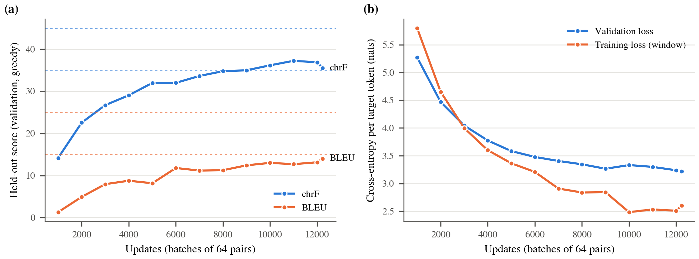

# How much training does a useful translator need?

| | |
|---|---|
| **Date** | 2026-10-25 |
| **Path** | Plain PyTorch on one machine; no Ygaraty distribution |
| **Result** | Minimal on chrF only (35 at update 10,000, ~1.06 PFLOP); BLEU stayed below 15. Test: chrF 35.5, BLEU 12.3. "Useful" not reached. |
| **Evidence** | `runs/experiments/022/Felipes-MacBook-Air-20261025-131822/` (`report.json`, `metrics.jsonl`, `best.pt`), not in git; figure in `figures/translation-quality-apple-m1.{png,pdf}` |

## Question

How many updates, tokens and FLOPs does our translation recipe need to reach a useful held-out quality on real data? Ygaraty's training matches PyTorch update for update, so this run tells us the quality Ygaraty would reach with the same recipe, and the compute budget it must deliver. Experiments 023 and 024 then ask how fast Ygaraty can deliver it.

## Setup

- **Data:** OPUS-100 English–Portuguese, downloaded by `ygaraty fetch-data`. Filters: 1–80 words per side, length ratio at most 3, exact duplicates removed. Training is a fixed 200,000-pair sample (seed 2026); validation is all 1,966 pairs and test all 1,969 after filtering. The data stays local (`runs/datasets/`): the dataset card lists the license as unknown. Its Portuguese is often European, not Brazilian.
- **Tokenizer:** SentencePiece unigram, 16,000 pieces, trained on the training pairs (both languages). Pairs longer than 64 pieces are dropped.
- **Model:** the attention-LSTM encoder–decoder Ygaraty implements (`ygaraty/reference/translator.py`). Two bidirectional encoder layers and two decoder layers, embedding 256, hidden 512, tied embeddings: 19.2M parameters.
- **Training:** the settings Ygaraty can run today. Adam (lr 1e-3, betas 0.9/0.999), batch 64, no dropout, no gradient clipping, no label smoothing, 4 epochs (12,500 updates). float32 on CPU; Ygaraty runs float64, which doesn't change the learning curve meaningfully. Batches are length-bucketed within windows of 100 batches.
- **Evaluation:** every 1,000 updates, teacher-forced validation loss on all validation pairs, plus greedy-decoded BLEU and chrF (sacreBLEU defaults) on the first 500. The best validation chrF checkpoint is scored once on the test set at the end.
- **FLOPs:** an estimate, 6 × parameters touched × tokens, counting encoder parameters per source token and decoder parameters plus the tied output projection per target token.

## Targets, fixed before running

| Level | chrF | BLEU |
|---|---:|---:|
| Minimal: gist mostly right | 35 | 15 |
| Useful: mostly readable | 45 | 25 |

We report the first update, target-token count and estimated FLOPs at which each level is reached on validation, or that it wasn't.

## Results

One run on an Apple M1 CPU: 12,232 updates (4 epochs over 195,661 pairs; 4,339 were longer than 64 pieces) in 2 hours 7 minutes, 0.5 s per update plus evaluations. Validation has 1,916 pairs and test 1,919 after the same length limit.



| Update | Target tokens | Est. FLOPs | Val loss | chrF | BLEU |
|---:|---:|---:|---:|---:|---:|
| 1,000 | 0.9M | 0.11 P | 5.27 | 14.2 | 1.3 |
| 3,000 | 2.7M | 0.32 P | 4.04 | 26.7 | 7.9 |
| 6,000 | 5.4M | 0.63 P | 3.48 | 32.0 | 11.8 |
| 9,000 | 8.1M | 0.95 P | 3.27 | 35.0 | 12.4 |
| 10,000 | 9.0M | 1.06 P | 3.33 | 36.2 | 13.0 |
| 11,000 | 10.0M | 1.16 P | 3.30 | **37.2** | 12.7 |
| 12,232 | 11.1M | 1.29 P | 3.22 | 35.5 | 14.0 |

| Target | Reached |
|---|---|
| chrF 35 (minimal) | update 10,000: 9.0M target tokens, about 1.06 PFLOP |
| BLEU 15 (minimal) | no; best 14.0 at the last evaluation |
| chrF 45, BLEU 25 (useful) | no |

**Test,** with the best-validation-chrF checkpoint (update 11,000) on all 1,919 test pairs: chrF 35.5, BLEU 12.3, loss 3.38. Validation chrF was picked as the best of 13 evaluations on 500 sentences, so the test score is the honest number.

What it means:

- **Quality is still rising slowly but is noisy.** chrF on 500 sentences moves by 1–2 points between evaluations (37.2, 36.9, 35.5 over the last three), about as much as it gains per 1,000 updates late in the run. Validation loss was still falling at the end (3.22), so this is not overfitting yet.
- **The minimal level is borderline, and "useful" is far.** Outputs at the end get short, common sentences right ("He's never done anything." → "Ele nunca fez nada."; "The episode was written by Ken Keeler…" nearly word for word) and lose the thread on long ones.
- **The budget so far:** about 1 PFLOP and 9M target tokens for a borderline-minimal translator with this model. On this M1, about 1.5 hours of one CPU's training.
- **Next for quality:** more data rather than more passes, and probably dropout. A run with `--train-size 1000000 --epochs 10` needs a GPU machine (the driver uses CUDA when present). Ygaraty can't run dropout yet, so a dropout run would show what we give up.

## Reproduce

```bash
pip install -e '.[translation,plot]'
ygaraty experiment 22
```

About 2 hours 10 minutes on an Apple M1 CPU (0.5 s per update, plus evaluations). Smaller trial: `ygaraty experiment 22 --epochs 0.1 --eval-every 100`.
