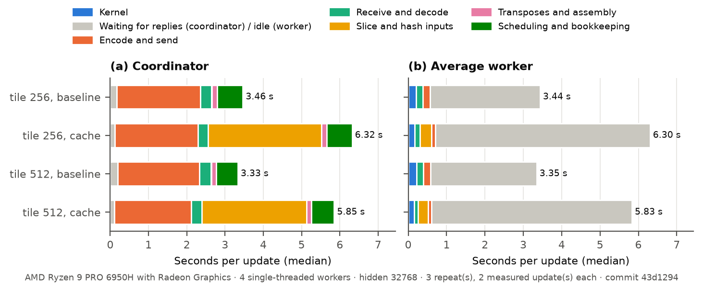
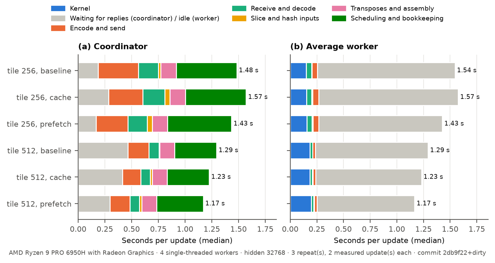

# Where does the coordinator's time go?

| | |
|---|---|
| **Date** | 2026-10-25 |
| **Path** | ZeroMQ, in-memory coordinator, 4 workers (same workload as experiment 21) |
| **Result** | On a Ryzen 9 PRO 6950H, the first profile found workers computing for only about 6% of each update. Most of the coordinator's time went to copying tiles of transposed matrices before sending them, at about 1% of normal copy speed; input caching made updates about 1.8× slower, because of content hashing. Three fixes, measured one at a time, brought an update at tile 512 from 3.35 s to 1.16 s (2.9× faster) and the kernel share to 17%, with identical losses. The 30% target is not met yet: per-task Python overhead and dependency stalls remain. |
| **Evidence** | Before: `public/research/figures/coordinator-profile-ryzen-6950h.{png,pdf}` (run `omarchy-20261025-151549`). After: `coordinator-profile-ryzen-6950h-after.{png,pdf}` (run `omarchy-20261025-200519`). Runs are in `runs/experiments/023/`, not synced. |

## Question

Experiment 21 found whole updates reaching about 4% of the workers' kernel capacity (about 7 GFLOP/s against roughly 4 × 50). Where does the rest go, and which changes recover it without changing the numbers?

## Setup

- **Workload:** the one from experiment 21. `ygaraty.examples.sized_mlp`, batch 64, 1024 → 32,768 → 512, real ZeroMQ server, transposes and assemblies on the coordinator, and 4 worker processes with one BLAS thread each.
- **Configurations:** tiles 256 and 512, each with caching off (`baseline`) and on (`cache`). Each run did 3 updates; the first was warm-up and the other 2 were measured. That was repeated 3 times, interleaved, so there are 6 measured updates per configuration. One `baseline` run at tile 256 also went through `cProfile`.
- **Machine:** AMD Ryzen 9 PRO 6950H (8 cores, 16 threads, 30 GB), Linux, Python 3.14.7, NumPy 2.5.4 with scipy-openblas, commit `43d1294`. The machine was quiet: load average 0.1 before the run and 1.3 after.

## First profile



Seconds per update, median of 6 updates. The coordinator's stages cover 100% of each update's wall time.

| Config | Wall (range) | Encode and send | Slice and hash | Scheduling and bookkeeping | Receive and decode | Waiting for replies | Worker kernel | Kernel / wall |
|---|---:|---:|---:|---:|---:|---:|---:|---:|
| tile 256, baseline | 3.44 (2.92–4.99) | 2.17 | 0.02 | 0.66 | 0.29 | 0.18 | 0.20 | 5.9% |
| tile 256, cache | 6.30 (4.90–6.78) | 2.17 | 2.95 | 0.67 | 0.27 | 0.12 | 0.17 | 2.7% |
| tile 512, baseline | 3.35 (2.90–4.68) | 2.13 | 0.01 | 0.56 | 0.30 | 0.20 | 0.21 | 6.4% |
| tile 512, cache | 5.83 (4.69–8.16) | 2.01 | 2.73 | 0.59 | 0.28 | 0.10 | 0.15 | 2.6% |

Worker kernel is the average worker's kernel time per update. "Kernel / wall" is the share of the update's wall time a worker spent computing, which is the ratio the success criterion targets. Transposes and assembly took about 0.14 s in every configuration.

| Config | MB sent | MB received | Median ms in flight |
|---|---:|---:|---:|
| tile 256, baseline | 1,899.5 | 1,094.7 | 1.04 |
| tile 256, cache | 1,560.5 | 1,095.4 | 1.40 |
| tile 512, baseline | 1,596.0 | 992.4 | 3.67 |
| tile 512, cache | 1,421.6 | 992.6 | 4.22 |

**The coordinator, not the workers, is the bottleneck.** The coordinator waits for replies for only 0.1–0.2 s per update. Workers are idle for about 2.8 s of the 3.4 s. Tile size barely matters here: 256 and 512 differ by less than the run-to-run noise.

**Encoding is a memory copy.** "Encode and send" is about 2.1 s per update, and 1.9–2.0 s of that is encoding. `cProfile` on the tile-256 baseline run attributes 8.8 s of 16.0 s in total to 23,457 calls to `numpy.ascontiguousarray`. Those calls come from `wire.send` (`ygaraty/runtime/wire.py:12`), which turns each strided tile slice into a contiguous float64 copy. `tobytes` then copies it again (0.3 s). The ZeroMQ send itself takes 0.7 s, and JSON encoding is negligible.

**Caching costs more than it saves.** It sends 10–18% fewer bytes. But hashing every input so the coordinator knows what workers hold adds 2.7–2.9 s per update, which roughly doubles the coordinator's work. As built, it should stay off for this workload.

**Parity held.** All 12 runs gave the same three losses (6.958757378, 2.149391670, 0.214466907), with no retries.

## Fixes, one at a time

Each change was profiled with this experiment, checked with `ygaraty parity check` (24/24 runs passed, none worse than the baseline, on the three LSTM cases), and run through the test suite. The losses were identical in every run.

| Step | Change | Tile 512, seconds per update (range) | Kernel / wall |
|---|---|---:|---:|
| Before | | 3.35 (2.90–4.68); 5.83 with caching | 6.4% |
| 1 | No copies on send or receive | 1.30 (1.23–1.45) | 14.4% |
| 2 | Cache keys are names, not content hashes | 1.27 (1.25–1.40) with caching | 14.6% |
| 3a | One finiteness check per result; no copies of the coordinator's own results | 1.21 (1.13–1.30) | 15.3% |
| 3b | `--prefetch 2`: each worker holds two tasks | 1.16 (1.12–1.31) | 16.9% |

**1. No copies.** Making a 256×256 tile of a transposed matrix contiguous took 5 ms; a tile of a normal matrix took 0.045 ms. The coordinator stores the transposes of the backward pass in column-major order, so most of its 2 s of encoding was these copies. Now `wire.send` sends such a tile as its transpose, marked `order: F`, and the receiver gets a free `.T` view, which BLAS takes as is. Arrays go to ZeroMQ with `copy=False` instead of `tobytes()`. Received arrays are read-only views of the frames, which commits keep without copying.

**2. Named cache keys.** Committed values never change during an update, and leaves that are not parameters never change at all. So `(run, step or "constant", value, region)` names a tile exactly, and neither the coordinator nor the worker hashes its content. Caching went from 1.8× slower than no caching to about 10% faster, sending 9% fewer bytes.

**3a. Less bookkeeping.** `Scheduler.results` checked every array for NaN and infinity, then `result` checked the last one again. The coordinator also copied its own transposes and assemblies, though their sources never change during an update.

**3b. Prefetch** keeps the next task queued at the worker while it computes. The gain is small (5% against caching alone), and it has a cost. A worker can evict a cached tile that a queued task still refers to, which costs one retry; this happened once in 18 runs. The result is still correct, because cache claims are hints, but `--prefetch` stays opt-in (default 1). Experiment 23 now profiles it as a third variant.



## Next

At 1.16 s per update, the coordinator spends 0.43 s on scheduling and bookkeeping, which is Python overhead of about 0.35 ms per task. It waits 0.30 s, mostly while assemblies and joins wait for their last parts. Sending takes 0.19 s, and its own transposes and assemblies 0.14 s. Reaching 30% needs fewer and larger messages: several tasks per message and larger fused tasks. After that, workers should read tiles from the tensor store directly, so the coordinator leaves the data path.

## Limits

This ran on a different machine from experiment 21 (Ryzen and OpenBLAS, not M1 and Accelerate), so compare the shares of time, not the absolute GFLOP/s. There were 6 measured updates per configuration, and the slowest update in each was 1.4–1.7× the fastest. Everything ran on one machine, so no real network was involved.

## Running it

```bash
ygaraty experiment 23
```

It writes `profile.json` (every stage, per update and per configuration) and `coordinator-profile.{pdf,png}` to the run folder. It takes about 3.5 minutes on the Ryzen before the fixes and 2.5 after and needs about 6 GB of free memory. Smaller trial: `ygaraty experiment coordinator_profile --hidden 2048 --workers 2 --steps 2 --repeats 1`.

## Success criteria

Whole-update throughput at tile 512 rises from about 7 to at least 30% of the workers' summed kernel throughput, on the same machine and workload, with parity unchanged. Report each change's effect separately, with repeats. **Status:** 6.4% before the fixes and 16.9% after them on the Ryzen, with parity unchanged. Not met yet.
