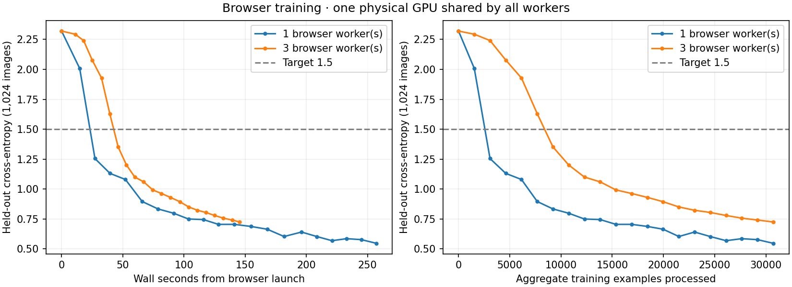

# One versus three browser workers: Fashion-MNIST training

Date: 2026-11-19–20 (Europe/Berlin). Local pilot; one physical Apple M1 GPU, 16 GiB host RAM.
All contributors used hardware WebGPU through Chrome 157.0.8103.79. This is
same-host concurrency, not three-GPU or multi-machine scaling.

## Question and result

Can three concurrent browser contributors improve time to a useful loss for
our Tape-compiled residual ConvNet under a matched sample budget?

Three contributors processed the budget **1.77× faster**, but
one contributor reached the predeclared common loss target sooner and achieved
better final loss/accuracy. Increased sample throughput did not improve time
to equivalent model quality in this pilot.

| Browser workers | Training examples | End-to-end seconds | Final test loss | Final test accuracy | Seconds to loss ≤1.5 |
| --- | --- | --- | --- | --- | --- |
| 1 | 30,720 | 257.18 | 0.546724 | 80.86% | 27.32 |
| 3 | 30,720 | 145.49 | 0.724771 | 73.63% | 46.28 |

One worker reached the three-worker final loss (0.724771) after
128.16 seconds. Three workers did **not** reach the
one-worker final loss (0.546724) within the matched budget. These are
first observed evaluation crossings; no interpolation is used.

## Fixed protocol

- Residual ConvNet, channels 8/16/16, Tape autodifferentiation, compiled Adam
  updates, no PyTorch training dependency. Each browser holds a complete replica.
- Verified Fashion-MNIST; seed 2026; local batch 16; 16 local steps per round;
  inner Adam learning rate 0.001; outer learning rate 0.7, Nesterov momentum 0.9.
- One worker: 120 rounds. Three workers: 40 rounds. Both consume 30,720 examples,
  approximately half an epoch, with deterministic disjoint worker shards.
- Evaluate the same first 1,024 held-out test images every 1,536 training examples:
  every 6 rounds for one worker, every 2 for three. Always evaluate the final round.
- Predeclared target loss 1.5; limit 900 seconds per arm; sequential order 1 then 3.
  One accepted seed/trial per configuration. No overlapping configurations.
- Warm dataset cache, fresh isolated Chromium profiles. Driver-level shader cache
  and host thermal state were not controlled. Network: measured HTTP over loopback.

The sample counts match, but the sample order/identities within the half-epoch
subsets differ by shard configuration. Three workers make fewer global updates
and fewer Adam steps per replica at the same aggregate sample count. This is a
comparison of these fixed DiLoCo settings, not a claim that three workers cannot
benefit from different optimizer settings or a larger budget.

## Measurement

The wall timer begins before server/browser startup and ends only after the
final evaluation and durable checkpoint transaction complete. Dataset loading
and the initial evaluation precede this timer. Training-time evaluations,
compilation, HTTP transport, synchronization, checkpoint I/O and polling delays
are included. Observation timestamps are sampled at approximately 0.1-second
intervals. Teardown and report writing are excluded.

HTTP request/response body bytes, including assets and protocol polling:
403,275,508 for one worker and 405,022,309 for three.
These exclude HTTP headers and lower-layer overhead; no network traffic is
emulated. Peak RAM/VRAM was not collected.

Every contributor reported nonzero GPU task counts and a non-fallback Apple
Metal 3 adapter. Three workers ran in separate Chromium processes. Summed local
worker durations divided by summed round durations were 1.60, consistent
with overlapping work; these processes still share one physical GPU.

## Evidence and reproducibility

- [Predeclared protocol and source/patch identity](results/convnet-one-vs-three/protocol.json).
- [Host and dependency versions](results/convnet-one-vs-three/environment.json).
- [One-worker report](results/convnet-one-vs-three/one-worker.json),
  [three-worker report](results/convnet-one-vs-three/three-workers.json),
  [comparison and complete curves](results/convnet-one-vs-three/comparison.json).
- [Timing correction](results/convnet-one-vs-three/timing-amendment.json) and
  [excluded initial trials](results/convnet-one-vs-three/initial-observer-race/README.md).
- [Commands to reproduce](../docs/distributed-training.md#compare-one-and-three-local-contributors).

The initial trials completed numerical training but were excluded from timing:
the observer could see the coordinator version advance before final evaluation
and checkpoint completion. Their final metrics remain preserved. Both arms were
rerun after observing only completed session transactions; their final model
loss/accuracy matched the initial trials exactly. This does not constitute
independent-seed statistical evidence.

The source is the uncommitted public branch `feature/public-diloco-training`,
base commit `5441492d12651021ca345715d12d5e536fc3c410`. Runtime source hashes and
configuration are in each raw report; the runner correction has a separate
hash in the amendment. No private runtime dependency or paid compute was used.
The experiment's Chromium processes and HTTP servers were stopped after each arm.

## Interpretation and next step

This establishes actual learning through our public Tape/compiler/browser
DiLoCo path. It does not establish convergence, heterogeneous hardware scaling,
WAN performance, or statistical superiority. Next compare independent seeds
and three physical GPUs, keeping explicit sample and wall-time budgets. Track
time to the same held-out loss rather than treating samples/second as the goal.
