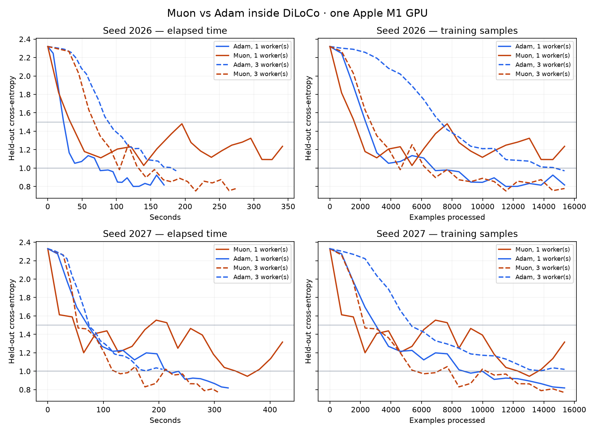

# Muon versus Adam inside local DiLoCo

November 24, 2026. Branch `feature/public-diloco-training`, public Ygaraty
Tape/compiler and Chromium WebGPU execution, one Apple M1 GPU with 16 GiB
unified memory. Eight successful runs: two seeds, one/three contributors,
Adam/Muon. **This is same-host concurrency, not physical multi-GPU scaling.**

## Result

Muon is implemented and trains successfully, but is not a universal improvement.
With three contributors it reached loss 1.5 sooner than Adam in both seeds:
median **65.38s versus 85.46s**, about 23.5% less time in this pilot. Its median
final held-out loss was **0.7734 versus 0.9953**, and accuracy **72.61% versus
61.23%**. Both three-worker Muon runs reached loss 1.0; only one three-worker
Adam run did.

With one contributor, Muon's median final loss was **1.2763**, worse than Adam's
**0.8175**. Its loss oscillated: seed 2027 crossed 1.0 once, then finished at
1.3163. A first target crossing is not evidence of sustained quality.
One-worker Adam had the fastest median time to the primary target (52.57s).

Muon took longer to process the full sample budget in both worker configurations.
Its better three-worker time-to-loss came from learning progress, not cheaper
updates. Optimizer SDK execution accounted for about **36–38%** of summed Muon
worker execution, versus about **1.1–1.2%** for Adam. These sums overlap between
contributors and must not be interpreted as wall-clock percentages.

Timing is noisy: the one-worker Adam runs took 169s and 325s despite identical
workload sizes. Host contention, thermal state and driver shader caches were not
controlled. Two seeds establish descriptive observations, not statistical
superiority or a portable speedup claim. Fixed learning rates were not tuned.

## All trials

Each arm consumed 15,360 training examples and evaluated the same 1,024 held-out
Fashion-MNIST test examples. Target times are seconds from launch to the first
observed committed evaluation; no interpolation or extrapolation. Missing
crossings remain missing and are never averaged as successful trials.

| Seed | Workers | Optimizer | Total seconds | Final loss | Accuracy | Seconds to loss ≤1.5 | Seconds to loss ≤1.0 |
| --- | --- | --- | --- | --- | --- | --- | --- |
| 2026 | 1 | adam | 169.35 | 0.816542 | 69.63% | 31.23 | 76.51 |
| 2026 | 1 | muon | 341.75 | 1.236261 | 50.88% | 53.40 | not reached |
| 2026 | 3 | adam | 187.12 | 0.970369 | 64.45% | 95.87 | 187.12 |
| 2026 | 3 | muon | 274.47 | 0.778564 | 72.46% | 76.05 | 104.33 |
| 2027 | 1 | muon | 422.51 | 1.316295 | 56.54% | 64.73 | 359.35 |
| 2027 | 1 | adam | 324.71 | 0.818398 | 66.70% | 73.91 | 223.00 |
| 2027 | 3 | muon | 307.94 | 0.768302 | 72.75% | 54.70 | 130.54 |
| 2027 | 3 | adam | 206.62 | 1.020258 | 58.01% | 75.04 | not reached |



The connecting lines are visual guides. Horizontal lines mark the predeclared
1.5 and 1.0 loss targets. [PDF figure](results/muon-diloco-local/learning-curves.pdf).

## Implementation and protocol

- Residual ConvNet, channels 8/16/16, batch 16, eight local steps per round.
  One worker runs 120 rounds; three workers run 40. Each holds a full replica.
- Adam uses learning rate 0.001, betas 0.9/0.999 and epsilon 1e-8. Muon applies
  to convolution matrices, flattened as [output channels, input channels × 9],
  with learning rate 0.02, momentum 0.95 and five Newton–Schulz iterations.
  Biases and the classifier retain Adam. Both arms use zero weight decay.
- The outer DiLoCo optimizer remains Nesterov, learning rate 0.7 and momentum
  0.9, including the one-worker baseline. This is not standalone vanilla Adam
  versus standalone vanilla Muon.
- Muon's momentum, normalization, matrix iterations and parameter updates are
  Tape nodes compiled into portable tasks. Matrix products execute on GPU;
  scalar/elementwise operations execute in the existing JavaScript CPU runtime.
  There is no PyTorch runtime dependency. The algorithm follows the
  [Muon reference](https://github.com/KellerJordan/Muon/blob/master/muon.py),
  but uses float64 CPU/compensated GPU arithmetic rather than BF16 iterations.
- Muon has one momentum tensor per convolution matrix; auxiliary Adam retains
  both moments. State layouts are carried in compiled plans, checked by the
  coordinator and persisted with the global weights and outer momentum.
- Optimizer arms at a given worker count share initialization and deterministic
  sample streams. Worker-count arms change shards, sample identities/order and
  number of global updates; matched sample budgets do not isolate hardware
  scaling. Each run covers only about a quarter of one epoch.
- Seeds are 2026 and 2027. The run order was Adam-1, Muon-1, Adam-3, Muon-3 for
  the first seed, then Muon-1, Adam-1, Muon-3, Adam-3. Runs never overlapped.
  No completed trial was discarded or selected for reporting.
- Evaluation occurs every 768 processed examples and at the final committed
  round. Time includes browser/server startup, plan compilation and transfer,
  local execution, coordination, training-time evaluation and durable checkpoint
  completion. Dataset loading and initial evaluation precede the timer; cleanup
  follows it. Peak RAM/VRAM was not measured.
- HTTP body bytes are retained per trial, including plans and protocol traffic;
  they exclude headers and lower-layer overhead. No WAN latency was simulated.

## Verification and next work

The Python suite passed **232 tests**, with two optional tests skipped; the
browser suite passed **137 tests**, including generated TypeScript checks.
Independent NumPy tests cover Muon updates for tall/wide/square matrices, zero
gradients and small compiler tiles. Node CPU execution matches the independent
reference. Mixed optimizer state survives durable restart; missing momentum
and changed optimizer configurations are rejected.

Additional real-GPU checks used the benchmark's 8/16/16 channels and batch 16,
two local steps and two rounds, then replayed the same updates in Python.
Maximum absolute final-weight errors were **7.36e-07** for one worker and
**3.24e-07** for three, below the fixed **5e-5** gate. These short
checks establish numerical parity, not full-run convergence equivalence.

The current implementation adds 45 small GPU matrix products per local step.
The SDK uploads inputs and reads each result back separately. Keeping optimizer
intermediates resident on GPU and fusing the iteration is a compiler optimization
candidate; these measurements do not isolate transfer cost from arithmetic.
Separately tune Muon's local learning rate and the outer update before claiming
an optimizer advantage. A controlled physical-GPU comparison remains untested.

## Reproduce and inspect

See the [Muon command-line guide](../docs/distributed-training.md#experimental-muon-local-optimizer).
From this branch with server dependencies and Chromium installed:

```sh
PYTHONPATH=. python tools/muon_experiment.py --seeds 2026 2027 \
  --samples 15360 --output runs/muon-comparison
python tools/compare_muon.py runs/muon-comparison --plot
```

Plotting additionally needs Matplotlib. The runner refuses an existing output
directory, records its protocol before starting and stops on failed trials.
Each harness closes the processes it started. All eight trials and both final
GPU parity checks completed; no remote machines were rented.

Source base: `5441492d12651021ca345715d12d5e536fc3c410` plus the uncommitted
DiLoCo/Muon implementation. Every timed run and final GPU parity check verified
the same runtime SHA-256: `5477185c3d5b7d806a9922dbc4ff21883e27c286219bee464a14b928f138984a`.

[Protocol](results/muon-diloco-local/protocol.json) ·
[Environment](results/muon-diloco-local/environment.json) ·
[Validated comparison](results/muon-diloco-local/comparison.json) ·
[Raw reports and logs](results/muon-diloco-local/) ·
[One-worker parity](results/muon-diloco-local/parity-1-worker.json) ·
[Three-worker parity](results/muon-diloco-local/parity-3-workers.json)
