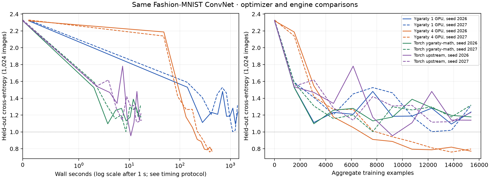

# Muon DiLoCo: GPU scaling and PyTorch comparison

**2026-11-24 · Fashion-MNIST · one host · RTX 3060 GPUs (12 GiB)**

Four Ygaraty workers completed the same sample budget **3.22× faster** than one
and reached loss 1.5 **2.50× sooner**. A single PyTorch GPU completed the workload
in about **17 seconds**, exposing a much larger execution-performance gap.

## Results

Medians over two seeds (2026, 2027). Each trial trained on 15,360 images;
evaluation used the first 1,024 test images.

| Implementation | GPUs | Time | Final loss | Accuracy | Time to loss ≤1.5 |
| --- | ---: | ---: | ---: | ---: | ---: |
| Ygaraty Deno/WebGPU | 1 | 1,390.43 s | 1.2763 | 53.71% | 278.36 s |
| Ygaraty Deno/WebGPU | 4 | 431.85 s | 0.7839 | 72.90% | 111.51 s |
| PyTorch, our optimizer equations | 1 | 16.82 s | 1.2485 | 61.62% | 3.69 s |
| PyTorch, upstream MuLoCo-1 | 1 | 17.30 s | 1.1851 | 58.59% | 4.79 s |

Both four-worker runs recorded loss below 1.0; neither one-worker Ygaraty run did.
All eight timed trials passed; none were discarded.

## Method and limits

- Residual ConvNet, channels 8/16/16; batch 16; eight local steps; 120 outer
  rounds with one worker, 30 with four. Muon learning rate 0.02; auxiliary Adam
  0.001; outer Nesterov learning rate 0.7, momentum 0.9; no weight decay.
- Four distinct GPUs were verified. Deno 2.9.5 used Vulkan and loopback HTTP
  with JSON tensors. PyTorch 2.9.1+cu128 used the same baseline GPU.
- Time includes training and periodic evaluation. PyTorch adds about 2.8 seconds
  of setup and omits Ygaraty's contributor HTTP, plan construction and durable
  round commits. This measures complete training paths, not isolated kernels.
- The upstream arm uses the pinned single-worker MuLoCo-1 implementation with
  our outer schedule. Its inner Muon differs in momentum, matrix scaling and
  Newton–Schulz arithmetic. The control uses our equations. PyTorch uses FP32;
  Ygaraty mixes FP64 host and FP32/compensated GPU operations.
- Short-run numerical checks passed: maximum weight error below 1e-6 for
  Ygaraty GPU runs and 2.2e-7 for the CUDA control. This does not imply identical
  long-run learning curves.
- Worker count changes data shards and outer-update count. Two seeds on one
  small model do not establish an optimizer winner or multi-machine scaling.
  Loss crossings are first observations at 1,536-sample evaluation intervals.

## Next step

**Prioritize GPU-resident training.** The current path uploads and reads back
individual GPU operations. Muon accounted for about 46% of worker execution
time. Profile these costs, reuse buffers and retain intermediate tensors on the
GPU before expanding the worker count. Outer-momentum tuning and compressed
updates are subsequent experiments.

## Evidence and cleanup

[Protocols, individual results and reproduction commands](results/muon-diloco-vast/README.md)
include source hashes and correctness checks. Tested source: DiLoCo branch work
based on commit `5441492d12651021ca345715d12d5e536fc3c410`; not a released version.

**Cost: $0.598.** Both experiment rentals were destroyed, no persistent volumes
remained, and temporary SSH keys were removed within 85.8 minutes.
[Setup failures](results/muon-diloco-vast/attempts.json) and
[cleanup verification](results/muon-diloco-vast/cleanup.json) are retained.
