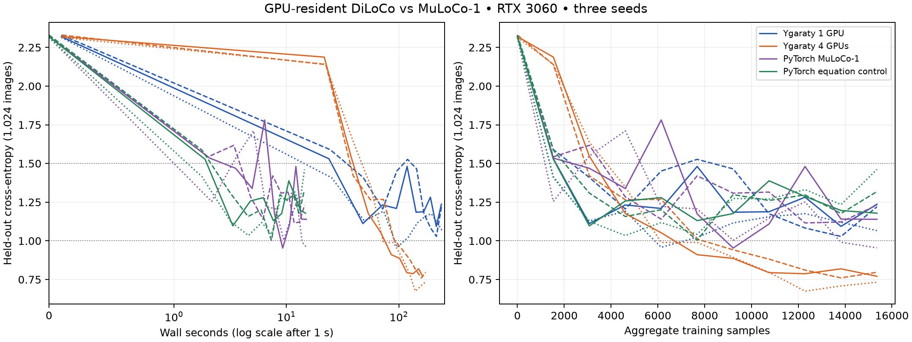

# GPU-resident DiLoCo versus MuLoCo-1

**2026-11-24 · Fashion-MNIST · three seeds · four RTX 3060 GPUs on one host**

**Four Ygaraty GPUs finished 1.40× faster than one and achieved lower final
loss. They did not beat single-GPU PyTorch MuLoCo-1 in runtime or time to loss 1.5.**

| Implementation | GPUs | Median time | Final loss | Accuracy | Time to loss ≤1.5 |
|---|---:|---:|---:|---:|---:|
| Ygaraty, GPU-resident | 1 | 239.57 s | 1.2200 | 60.06% | 47.93 s |
| Ygaraty, GPU-resident | 4 | 171.27 s | 0.7710 | 73.34% | 53.54 s |
| PyTorch, upstream MuLoCo-1 | 1 | 15.05 s | 1.1393 | 59.38% | 3.53 s |
| PyTorch, our optimizer equations | 1 | 14.52 s | 1.3184 | 60.45% | 3.18 s |

All arms reached loss 1.5 in all three seeds. Four workers took **12% longer**
than one to that threshold, despite completing the full budget sooner.
Loss 1.0 was reached in **3/3** four-worker trials (median 85.83 s), **1/3**
one-worker Ygaraty trials, **2/3** upstream trials and **0/3** equation controls.
These are first observed crossings; loss can subsequently increase.

Solid, dashed and dotted lines represent seeds 2026, 2027 and 2028. PyTorch
setup is reported separately; its plotted clock starts at training.

## What remains expensive

Every Ygaraty worker used full-round residency: zero CPU tensor tasks and one
readback per eight-step round. This was checked in every timed trial.

For four workers, median summed round time was **152.89 s**, versus **31.46 s**
for the sum of each round's slowest local worker. Worker timing excludes
assignment preparation/transfer and result submission. Complete wall time also
includes startup, evaluation and persistence. HTTP request/response bodies total
about **267 MB per trial**, even with GPU residency.

Profile coordinator plan construction, serialization and polling next. This
breakdown does not isolate their individual costs. Local execution also needs
work: removing all time outside the measured worker intervals would still leave
about 31 seconds for four workers, versus 15 seconds for the upstream baseline.
Worker timings include host encoding; they are not GPU timestamp measurements.

## Method and limits

- Twelve timed trials, none excluded. Each trains on 15,360 samples; evaluation
  uses 1,024 test images every 1,536 samples. ConvNet channels 8/16/16, batch 16,
  eight local steps; 120 rounds with one worker, 30 with four. Arm order varies
  across seeds. No thermal/cache reset.
- Muon learning rate 0.02, auxiliary Adam 0.001, outer Nesterov learning rate
  0.7 and momentum 0.9. Upstream inner momentum, scaling and arithmetic differ.
  Its revision is pinned; these settings match our earlier comparison.
- Ygaraty time includes contributor startup, training and evaluation. PyTorch
  setup is separate (recorded in each report). Dataset loading and the initial
  Ygaraty coordinator evaluation are excluded. These are complete execution
  paths with different overhead, not isolated kernel timings.
- Four distinct physical GPUs verified; CUDA and Vulkan single-worker devices
  matched. NVIDIA passed 19 kernel cases and failure gates, one/four-worker
  CPU-reference checks (maximum weight error 2.26e-6, tolerance 5e-5), and the
  PyTorch reference check.
- Same-host loopback HTTP with JSON tensors. This does not test WAN links,
  heterogeneous devices or multi-host scaling. Worker count changes data shards
  and outer-update count; lower final loss does not establish optimizer superiority.
- The four-GPU host stayed allocated during single-GPU trials. Four-worker
  Ygaraty used about 2.86× the active GPU-seconds of one-worker Ygaraty for this
  sample budget. This is not evidence of a rental-cost advantage.

The [older benchmark](muon-diloco-vast.md) measured 1,390/432 seconds for Ygaraty
on one/four RTX 3060s. The new times are substantially lower, but the host and
candidate changed; this rerun is not a controlled measurement of residency alone.

**Provider-reported total cost: $0.215, against a $3 cap.** Both created rentals
were destroyed (the first failed during startup), no experiment instances or
created volumes remain, and temporary SSH keys were removed. Cleanup completed
36.62 minutes after first provisioning, within the two-hour deadline.

[All trials, source hashes, checks and reproduction commands](results/resident-training-nvidia/README.md).
The candidate is based on `9867b7e96a9c`; changes are not a released version.
