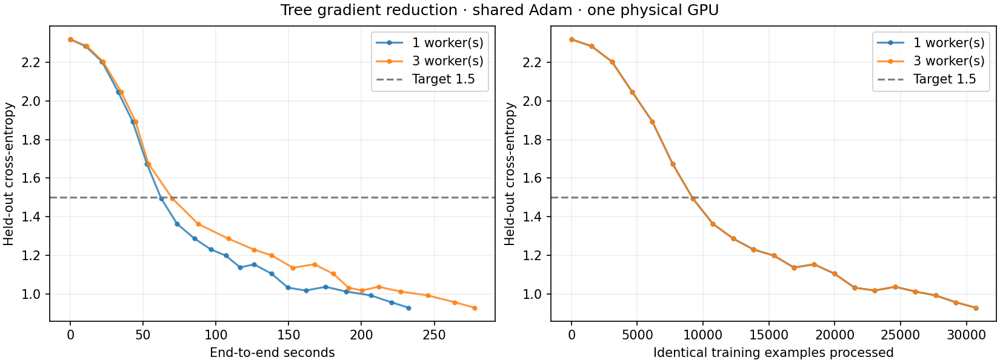

# Tree gradient reduction: matched global-batch ConvNet training

Date: 2026-11-20 (Europe/Berlin). One Apple M1 GPU, 16 GiB RAM, hardware
WebGPU through separate Chromium processes. Local algorithm pilot, one seed.

## Question and result

Does splitting a global batch across three workers, reducing mean gradients
through a sample-weighted binary tree, and applying one shared Adam update
preserve the one-worker learning behavior?

**Yes for this pilot's learning-quality gates; no performance improvement on
this single GPU.** Both arms used exactly the same 30,720 example IDs in the
same order and the same 640 global optimizer updates.

| Workers | Per-worker batch | Global Adam updates | Total seconds | Final held-out loss | Accuracy | Seconds to loss ≤1.5 |
| --- | --- | --- | --- | --- | --- | --- |
| 1 | 48 | 640 | 232.42 | 0.927542 | 67.77% | 62.46 |
| 3 | 16 | 640 | 277.79 | 0.927498 | 67.77% | 70.10 |

Three workers took 19.5% longer. Their final loss differed
by 0.00004397, and classification accuracy was identical.
The predeclared gates were absolute final-loss difference ≤0.05 and accuracy
difference ≤0.02. Both passed.

## What the tree does

Every worker receives the same model version and computes the gradients of its
partition's **mean** loss, without a local optimizer step. Adjacent nodes combine
using their sample counts:

`g_parent = (n_left * g_left + n_right * g_right) / (n_left + n_right)`.

An odd leaf is carried to the next level. With three leaves, the coordinator
merges workers 0 and 1, then merges their result with worker 2. Unequal partitions
are supported and tested. One shared Adam state and clock advance only after
every gradient is available. Tape builds forward/backward graphs; optimizer
tasks are pruned from leaf plans. Shared Adam uses the existing Ygaraty compiler
and CPU task runtime. No PyTorch training dependency is used.

**The tree reduction is executed on the coordinator CPU.** Leaf gradients travel
through authenticated HTTP to that coordinator. This is a tree *algorithm* over
a star transport, not peer-to-peer network reduction or a demonstration of
communication savings. All browser processes share one physical GPU.

## Numerical validation

Before either long run, five hardware-GPU steps per arm were checked against
full-global-batch CPU gradients at the corresponding model weights. The maximum
CPU-reference gradient error was 2.36e-07, below the fixed 2e-5 gate.

Between the one- and three-worker GPU arms:

- First gradient maximum absolute difference: 1.91e-07.
- First shared Adam weight maximum absolute difference: 2.33e-09.
- At the end of the five-step probe, maximum weight difference: 2.17e-8.
- After 640 updates, maximum weight difference: **0.003800**.
  Final first/second-moment differences were 0.001169 and 0.000191.

The long-run weights are therefore **not bitwise identical**, despite the almost
overlapping loss curves. This is consistent with float32 reduction-order errors
accumulating through nonlinear training; this run does not isolate their exact
contribution from activation-boundary effects. Do not interpret the quality
agreement as exact long-run parameter equivalence.

Separate float64 tests compare an unsplit seven-example batch with uneven
3/2/2 partitions over four shared Adam updates, including moments and weights,
at 1e-12 absolute tolerance. They also verify shared Adam against the existing
compiled Trainer, and reject empty/nonfinite/mismatched reductions without
advancing the optimizer.

## Fixed protocol and measurement

Fashion-MNIST, seed 2026; residual ConvNet channels 8/16/16; global batch 48;
Adam learning rate 0.001, beta1 0.9, beta2 0.999, epsilon 1e-8. No DiLoCo outer
optimizer, local Adam at leaves, dropout, or batch-dependent normalization.
One trial per arm, sequential order 1 then 3, at most 900 seconds each. Dataset
cache warm; fresh browser profiles. Driver shader-cache and thermal state were
not controlled.

Both arms evaluate the same first 1,024 held-out test images every 32 global
updates (1,536 examples), including the final update. Time to target is the first
observed evaluation crossing, with no interpolation. Wall time includes
server/browser startup, gradient plan compilation, transport, synchronization,
shared Adam, periodic/final evaluation and final snapshot file writing. Dataset
loading and initial evaluation are outside the timer; teardown is excluded.

Measured HTTP bodies totaled 403,278,282 bytes for one worker and
624,685,226 for three. These include assets and polling and exclude
headers and lower-layer overhead. The run does not isolate GPU kernel time or
profile where the overhead occurs. Peak RAM/VRAM was not measured.

Unlike the earlier [DiLoCo pilot](convnet-one-vs-three.md), these arms have equal
optimizer-step counts and identical global batches. Its absolute accuracy and
timing numbers are not controlled comparisons against this different optimizer
regime. This pilot tests whether synchronous reduction preserves one-worker
learning, not whether it is more accurate than DiLoCo.

## Evidence and reproduction

- [Frozen protocol, source commit/patch and runner hashes](results/tree-gradient/protocol.json).
- [Host/dependency information](results/tree-gradient/environment.json).
- CPU-reference probes: [one](results/tree-gradient/probe-one.json),
  [three](results/tree-gradient/probe-three.json).
- Training reports: [one worker](results/tree-gradient/one-worker.json),
  [three workers](results/tree-gradient/three-workers.json).
- [Comparison and curves](results/tree-gradient/comparison.json).
- Gradient/weight/moment snapshots: [one](results/tree-gradient/one-worker.npz),
  [three](results/tree-gradient/three-workers.npz).
- [Commands](../docs/distributed-training.md#experimental-tree-gradient-reduction).

Runtime source SHA-256: `5dad343f8d965f4135ab6ae70b982ab69fa579b82d9301455a785ee6e02424e1`.
Identical sample-sequence SHA-256: `e9be7415fcde7f331390a13a767e822a80da9fead7e843bc963d271d29a064d7`.
The tested source was an uncommitted snapshot before the DiLoCo merge into `main`, based on
`5441492d12651021ca345715d12d5e536fc3c410`, not a released version.
All four GPU runs (two probes and two training arms) completed. No paid resources
were used. Experiment browser processes and HTTP servers were stopped.

## Next question

Test independent seeds and separate physical GPUs before making scaling claims.
A true network tree needs peer reducers and communication measurements; native
wgpu workers are another independent comparison. The useful result here is that
averaging gradients **before** the shared optimizer preserves learning quality,
while this same-GPU implementation has higher communication volume and wall time.
