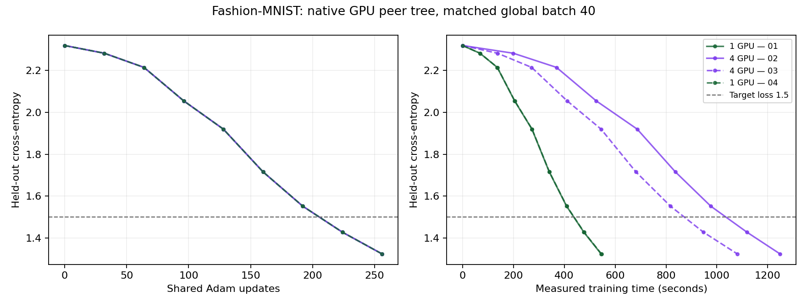

# Native peer-tree training: one versus four physical GPUs

Date: November 20, 2026. Experimental public Ygaraty code, four RTX 3060
machines on Vast.ai, Deno 2.9.5 with native wgpu/WebGPU. No browser or PyTorch
training dependency.

**Result:** real peer-to-peer training passed numerical checks and preserved
learning quality, but four GPUs took **2.14× longer** than one
for this small workload over these internet links. This is synchronous
sample-weighted gradient reduction with one shared Adam optimizer, not DiLoCo.

## Measured results

Each trial used 256 shared Adam updates, global batch 40, and exactly the same
10,240 example IDs in the same order. Two repetitions per arm, order 1, 4, 4, 1.
The first observed held-out loss ≤1.5 occurred at update 224 in every trial.

| Trial | GPUs | Total seconds | Final held-out loss | Accuracy | Seconds to loss ≤1.5 |
| --- | --- | --- | --- | --- | --- |
| trial-01-1gpu | 1 | 545.08 | 1.32356978 | 56.35% | 476.91 |
| trial-02-4gpu | 4 | 1249.60 | 1.32364397 | 56.45% | 1118.28 |
| trial-03-4gpu | 4 | 1081.54 | 1.32364397 | 56.45% | 947.19 |
| trial-04-1gpu | 1 | 546.10 | 1.32356978 | 56.35% | 477.78 |

Median elapsed time was **545.59s** for one GPU and
**1165.57s** for four. Median time to the fixed loss target was
**477.34s** versus **1032.73s**.
The final loss difference was 0.00007419; accuracy differed
by one of 1,024 test examples. These are short learning runs, not fully converged
Fashion-MNIST models.



Markers show actual evaluations; connecting lines are visual guides. Target
crossing times use the first observed evaluation, without interpolation.

## What ran

- Residual ConvNet, channels 8/16/16, seed 2026, Adam learning rate 0.001,
  betas 0.9/0.999, epsilon 1e-8. Tape creates forward/backward computation;
  Ygaraty compiles and executes the gradient and optimizer plans.
- One full model replica per worker: batch 40 on one GPU, or batch 10 on each
  of four GPUs. Root 0 has children 1 and 2; worker 1 has child 3.
  Gradients reduce up those edges and weights broadcast back down them.
- The Python coordinator on worker 0 sends plans and input batches to each
  worker. It receives root checkpoints, not individual leaf gradients for
  centralized reduction. Native workers use GPU and CPU tasks; root Adam
  executes through the compiled CPU task runtime.
- Binary tensor bodies use the public YGT1 transport. Peer connections use
  direct encrypted SSH forwarding with separately generated, forwarding-only
  host keys. Private keys remain on their source hosts. Worker HTTP listeners
  bind only to loopback. This is host-memory transport, not GPU-direct/RDMA.
- Four distinct physical GPU identities and machines were verified privately.
  All adapters reported hardware RTX 3060s with 12 GiB VRAM. Two hosts were in
  Poland, one in Spain and one in Quebec. CPU models, allocated CPU shares and
  NVIDIA drivers differed; see [hardware](results/vast-native-one-vs-four/hardware-public.json).

This is **not a LAN benchmark**. Individual one-byte request observations were
about 0.12–0.43s to the remote workers, with an earlier outlier near 2.78s.
These are diagnostic samples, not a stable latency distribution. Payload probes
exceeded their bounds, so no sustained bandwidth estimate is claimed.

Local gradient execution did become faster: in the first pair, median local
execution was 2.02s for one worker versus 0.72s for the slowest of four workers.
Those times include CPU and GPU tasks. End-to-end updates still took longer;
transport, plan preparation, coordination and optimizer overhead outweighed
that reduction. This experiment does not isolate each overhead or predict a
low-latency LAN result.

## Correctness and timing boundaries

Before timing, three updates per configuration were checked against the unsplit
Python reference. Maximum absolute weight error was **1.39e-06**,
below the fixed 2e-5 gate. All timed runs checked complete tree membership and
model version on every update. Dataset, sample-sequence and runtime hashes match.
All final weights are finite; all four adapters are hardware GPUs.

Final one-versus-four weights are not bitwise identical: maximum absolute
difference is **0.002148**. The maximum difference
between repetitions is 0 for one GPU and
0 for four GPUs. Close learning curves should
not be interpreted as exact cross-partition floating-point equivalence.

The timer starts after dataset loading, initial weight distribution and initial
evaluation. It includes per-update compilation/preparation, native execution,
transport, synchronization, evaluation every 32 updates, and final checkpoint
writing. Installation and worker startup are excluded. CPU-reference checks
run separately, not inside timed trials. Every trial uses fresh workers and a
new session; dataset caches are warm. Driver shader caches and host contention
are not controlled.

Two repetitions with one seed provide descriptive timing evidence, not a
statistical scaling claim. The 1,024 evaluation examples are the same fixed
held-out subset throughout. The remaining research question is whether lower
latency, larger computations, or fewer synchronization rounds change the result.
DiLoCo would be a separate learning experiment because it changes update semantics.

## Reproduce the workload

Install the same public revision and Deno on each host, verify hardware adapters,
and create a fresh session as described in the [native training guide](../docs/native-training.md).
Use an encrypted private network or equivalent direct peer SSH forwarding for
internet connections. Do not expose session secrets over public plaintext HTTP.

```bash
ygaraty train lan run --config lan-session/coordinator.json \
  --num-workers 4 --dataset fashion-mnist --global-batch 40 \
  --channels 8 16 16 --seed 2026 --steps 256 \
  --eval-examples 1024 --eval-interval 32 --verify-steps 0 \
  --timeout 2400 --output runs/four-gpu/report.json
```

Run `--steps 3 --verify-steps 3 --eval-examples 16` in a separate fresh session
for the parity preflight. For the baseline, generate a one-worker session and
change `--num-workers` to 1; keep the training and evaluation budgets unchanged.

Source base: `5441492d12651021ca345715d12d5e536fc3c410` plus uncommitted public implementation
changes. Runtime hash: `14f4648635ae5642fff90a60c122cef95f7a51dc51620207e6d714eed43d200e`.
The [protocol](results/vast-native-one-vs-four/protocol.json) records the complete
implementation-patch and installed-wheel hashes. Every host verified the same
runtime hash. Only the public wheel and public runtime dependencies were used.

## Attempts, budget and cleanup

The initial four-host placement could not route directly through its shared
public address. Its provider-SSH fallback worked but had approximately 0.55–0.57s
round trips. Three hosts were replaced before the accepted comparison. One
replacement download required a bounded retry. Failed connectivity/bandwidth
probes and the interrupted 640-update sizing run are retained in the
[attempt record](results/vast-native-one-vs-four/attempts.json).

Before any accepted trial finished, the protocol was reduced from 640 updates
and three repetitions to 256 updates and two repetitions, based on measured
throughput and the original two-hour teardown deadline. No completed timed trial
was discarded. The same reduced budget was applied to both arms.

The authorized total cap was $11.48. Estimated rental and instance-disk cost was
**$0.330**, excluding separately billed traffic.
Observed account-credit decrease from the supplied starting balance was
**$0.349**, including setup and earlier brief attempts;
billing may lag. See the [cost basis](results/vast-native-one-vs-four/cost.json).

An independent watchdog was active before provisioning. The three extra GPUs
were destroyed after their final run; the baseline host was destroyed after its
last checkpoint was downloaded. Final provider inventory verified **zero
experiment instances and zero persistent volumes**. Instance disks were deleted
with their rentals, and the local temporary SSH key was removed. No resources
were left running. [Cleanup evidence](results/vast-native-one-vs-four/cleanup.json).

[Summary](results/vast-native-one-vs-four/summary.json) ·
[Validation](results/vast-native-one-vs-four/validation.json) ·
[Per-trial reports and weights](results/vast-native-one-vs-four/)
